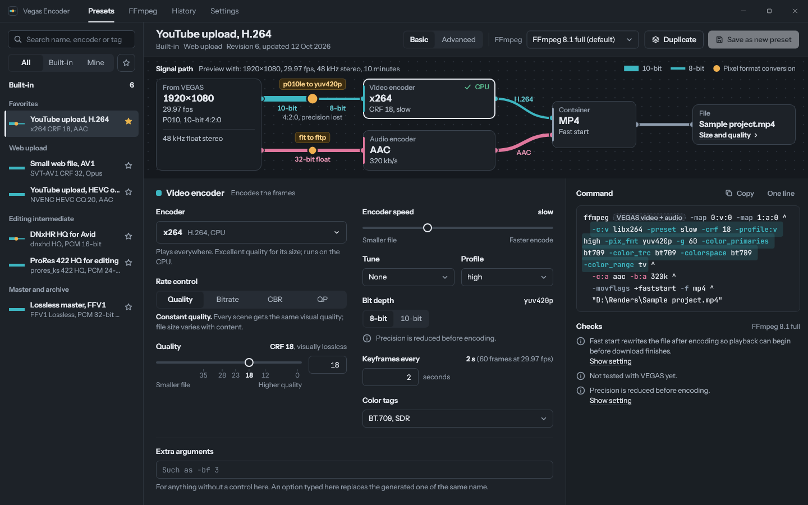
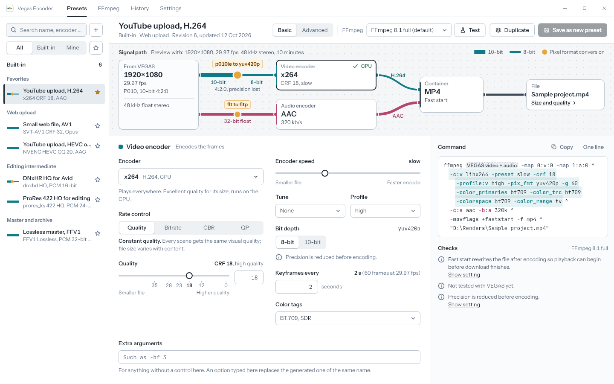
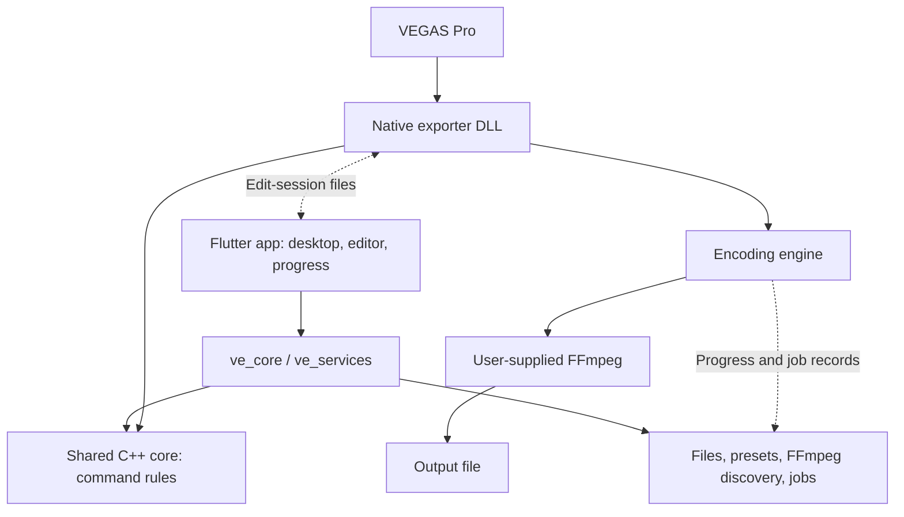

<div align="center">


# Vegas Encoder

**Render from VEGAS Pro with the flexibility of FFmpeg.**

A native Render As exporter and companion desktop app for choosing encoders,
building presets, and seeing how your video and audio reach the output file.

[](#requirements)
[](#vegas-pro-compatibility)
[](https://flutter.dev)
[](#installation)

[Features](#features) · [Installation](#installation) · [Encoders](#encoders-and-formats) · [For developers](#for-developers)

</div>

---

## Why Vegas Encoder?

Choose your own FFmpeg build and use its encoders directly from VEGAS Pro's
**Render As** dialog. Prepare presets in the desktop app, then load or adjust
them in the VEGAS editor popup without exporting an intermediate file first.

The signal-flow view connects the source, video encoder, audio encoder, container,
and destination. It shows pixel-format conversions and bit-depth changes alongside
the generated FFmpeg command, so encoding decisions are easier to understand.

## Screenshots

<table>
  <tr><th>Dark mode</th><th>Light mode</th></tr>
  <tr>
    <td><a href="app/test/golden/goldens/presets_native_video_dark.png"></a></td>
    <td><a href="app/test/golden/goldens/presets_native_video_light.png"></a></td>
  </tr>
</table>

Click either image for full size. These previews show the implemented Flutter UI
with test data, rather than live VEGAS renders.

## Features

- **Native VEGAS integration** — render through a FileIO exporter, with a separate
  settings popup that shares the desktop app's editor.
- **Basic and Advanced modes** — use curated quality, bitrate, speed, profile,
  and bit-depth controls plus Extra arguments, or edit an FFmpeg command with
  highlighting, checks, and completion.
- **Preset library** — start with built-in presets, duplicate and customise them,
  import/export presets, and save settings into VEGAS templates.
- **Visible signal path** — inspect video and audio separately, including format
  conversions, container settings, and the command preview.
- **FFmpeg discovery and hardware checks** — manage local FFmpeg installations,
  inspect capabilities, and test hardware encoders on your machine.
- **Preset tests** — run a small synthetic encode from the desktop app before
  committing to a full render.
- **Progress and History** — follow encoding in a small progress window and review
  recorded jobs, failures, and logs.
- **Light and dark themes** — follow Windows or choose an appearance in Settings.
- **VEGAS installation status** — inspect detected hosts and plug-in status from
  Settings. Installation and repair are handled separately.

## Requirements

- **Windows x64** and a compatible **VEGAS Pro** installation for rendering.
- **Your own FFmpeg and FFprobe**, with `ffprobe.exe` beside `ffmpeg.exe`.
  FFmpeg is not bundled or downloaded by the app; select your installation on
  the **FFmpeg** page. Available codecs depend on that build.
- The **Microsoft Visual C++ x64 runtime** required by the desktop app.
- For GPU encoding, a compatible GPU and driver plus an FFmpeg build containing
  the chosen hardware encoder. The app's hardware test checks whether it works
  on this PC.

The desktop app can manage presets and test FFmpeg without running VEGAS.

## VEGAS Pro compatibility

| Host | Current status |
| --- | --- |
| **Boris FX VEGAS Pro 2026.0.3.189 x64** | Tested with the **0.1.7 development trials** at the scope below |
| VEGAS Pro 23, 22, 21, and Sony VEGAS Pro 13 | Installation detection only; exporter compatibility is unqualified |
| Other builds or versions | Untested |

On the tested 2026 build, owner-confirmed checks include basic renders, normal
saved-template persistence across restart, cancellation/recovery, failure
presentation, and immediate reopening of a large preset. Container trials also
confirmed MP4, MOV, and WebM renders for specific recipes, plus correct settings
handoff for all five supported containers.

This is still a development build. MXF rendering and the latest MKV regression
were skipped; the separate two-container restart sequence and exact large-template
save/restart sequence remain unconfirmed. Additional same-session encoder-failure
recovery and faster-progress performance trials are deferred. Broader HDR, colour,
alpha, audio-only, and host-version support are not qualified. See
[current status](docs/STATUS.md) for the tested builds and precise limits.

## Encoders and formats

The Basic editor currently includes these encoder profiles:

| Category | Encoders |
| --- | --- |
| CPU video | H.264 (**x264**), HEVC (**x265**), AV1 (**SVT-AV1**), VP9 (**libvpx VP9**) |
| NVIDIA | **NVENC H.264**, **NVENC HEVC**, **NVENC AV1** |
| Intel | **Quick Sync HEVC** |
| AMD | **AMF H.264** |
| Editing and archival | **ProRes** (`prores_ks`), **DNxHR** (`dnxhd`), **FFV1** |
| Audio | **AAC**, **Fraunhofer AAC**, **Opus**, **FLAC**, **Apple Lossless**, **PCM 16/24-bit and 32-bit float**, **AC-3**, **E-AC-3**, **MP3 (LAME)** |

VEGAS output containers are **MKV, MP4, MOV, WebM, and MXF**. Choose a codec/audio
combination that the container accepts; not every encoder works with every format.

These are app profiles, not a guarantee that every FFmpeg build contains every
encoder or that every combination has been tested in VEGAS. The app checks the
selected FFmpeg installation and reports missing capabilities. Advanced commands
remain subject to the exporter's input, mapping, and output restrictions.

## Installation

Download the Windows x64 installer from the
[**GitHub Releases page**](https://github.com/Kidsnd274/vegas-encoder/releases).

> [!NOTE]
> The setup installer is currently being prepared. Downloadable installers will
> be published on the Releases page when ready.

1. Download the setup `.exe` from the release's **Assets** section.
2. Close VEGAS Pro and any Vegas Encoder windows, then run Setup and follow its
   instructions to install the app and VEGAS plug-in.
3. Launch **Vegas Encoder**. On the **FFmpeg** page, select your own FFmpeg
   installation and check its available encoders. FFmpeg and FFprobe are supplied
   separately; see [Requirements](#requirements).
4. Start VEGAS Pro and open **Render As** to use Vegas Encoder.

To build or contribute to the project, see [For developers](#for-developers) below.

## Quick start

1. Open **Presets**, choose a built-in preset, and duplicate it to customise the
   encoder, audio, and container.
2. Use **Test** for a short synthetic encode with your selected FFmpeg. This does
   not test a complete VEGAS project.
3. In VEGAS, open **Render As**, select Vegas Encoder, and open its custom settings.
   Load your preset, adjust it, and apply the settings.
4. Save a VEGAS template to reuse those settings. Choose a fresh output filename
   with the matching container extension and start the render.
5. Follow the progress window, if enabled, or review the job in **History** afterward.

## Feedback

[Open an issue](https://github.com/Kidsnd274/vegas-encoder/issues) with your exact
VEGAS build, Vegas Encoder version, FFmpeg version, encoder/GPU details, and the
error message or relevant log excerpt.

---

# For developers

The app, exporter, development tools, tests, and CI target **Windows x64**.
Builds and fake-host checks are self-contained; the historical investigation
checkout is not required. Imported code provenance is in [ORIGIN.md](ORIGIN.md).

- [Vegas Encoder](#vegas-encoder)
  - [Why Vegas Encoder?](#why-vegas-encoder)
  - [Screenshots](#screenshots)
  - [Features](#features)
  - [Requirements](#requirements)
  - [VEGAS Pro compatibility](#vegas-pro-compatibility)
  - [Encoders and formats](#encoders-and-formats)
  - [Installation](#installation)
  - [Quick start](#quick-start)
  - [Feedback](#feedback)
- [For developers](#for-developers)
  - [Set up the development environment](#set-up-the-development-environment)
  - [Build the product](#build-the-product)
  - [Change the version](#change-the-version)
  - [Run checks](#run-checks)
  - [Repository layout](#repository-layout)
  - [Architecture](#architecture)
  - [License](#license)

## Set up the development environment

Install or provide:

- **Git**, **PowerShell 7**, and **Python 3.9+**.
- **Flutter with Dart compatible with `^3.13.5`**, as declared in
  [app/pubspec.yaml](app/pubspec.yaml). The recorded development baseline uses
  Flutter **3.47.7**; retain the lockfiles and use a compatible SDK.
- **Visual Studio's Desktop development with C++ workload**, including MSVC x64
  C++17 tools, CMake, and a Windows SDK. See Flutter's
  [Windows setup guide](https://docs.flutter.dev/platform-integration/windows/setup).
- **FFmpeg and FFprobe** for encoding and media checks.
- **Inno Setup** only when working on the installer; it is not needed for the
  product build or tests.

```powershell
git clone https://github.com/Kidsnd274/vegas-encoder.git
Set-Location vegas-encoder
flutter doctor -v
python -I scripts/etc/Generate-Versions.py
python -I scripts/etc/Generate-CoreData.py
Push-Location app
flutter pub get
flutter run -d windows
Pop-Location
```

Resolve Windows/Visual Studio toolchain issues reported by `flutter doctor`
before building. For native scripts, use an x64 MSVC developer environment,
set `VEGAS_ENCODER_VCVARS` to `vcvars64.bat`, or pass the tool path explicitly.
Local `L:` paths are conveniences for the maintainer's machine, not requirements.

Before contributing, read [AGENTS.md](AGENTS.md), the
[product decisions](docs/product/README.md), [workflow](docs/product/WORKSTREAMS.md),
[status](docs/STATUS.md), and [current queue](docs/NEXT_AGENT.md).

## Build the product

From the repository root in PowerShell 7:

```powershell
# Build the exporter and app, then stage a fresh matched installer-input bundle.
.\scripts\Build-Release.ps1 -OutputDir "$PWD\build\my-installer-inputs"

# Compile without staging.
.\scripts\Build-Release.ps1 -Action Build

# Stage the recorded build without recompiling, using a new output directory.
.\scripts\Build-Release.ps1 -Action Package -OutputDir "$PWD\build\my-repack"
```

Use a fresh output directory for each staging run. Omitting `-OutputDir` chooses
a new timestamped directory under `build/releases/`. Package-only refuses changed
version, source, or runtime inputs; rebuild when those inputs change.

The script generates versions/core data, resolves Flutter dependencies, builds the
native exporter and app, publishes `build/release/vegas-encoder/{app,core,plugin,setup}`,
records the build, stages matched inputs, and compiles the installer into `dist/`.
Tool overrides are `-FlutterPath`, `-PythonPath`, `-VcVarsPath`, and `-IsccPath`.
It does not run tests, install the exporter, or run Setup. See the
[installer guide](docs/INSTALLER.md) for app/VEGAS 2026 options and recovery.

The staged `app/` is the complete runtime; `plugin/` holds the exporter DLL and INI.
Keep them matched. The exporter statically links its own core; replacing the app's
core DLL alone does not update the exporter. See [the build guide](docs/BUILDING.md)
for lower-level commands and [installer inputs](docs/B7_INSTALLER_INPUTS.md) for
packaging requirements. Build and test output is ignored by Git.

## Change the version

Edit **[version.json](version.json)** at the repository root:

| Field | Purpose |
| --- | --- |
| `release.version` | Product release, for example `0.1.7` |
| `release.build` | Build number; `1` produces app `0.1.7+1` and Windows file version `0.1.7.1` |
| `release.exporterSuffix` | Optional exporter label suffix; empty removes it |
| `core.version` / `core.packageVersion` | Core runtime stamp and Dart package version |
| `services.packageVersion` | Services Dart package version |
| `core.abi` / `core.schemaMax` / `core.contracts` | Actual interface/format compatibility levels, not release counters |

Then run `Build-Release.ps1` to regenerate and rebuild the matched product.
`Generate-Versions.py` projects the JSON into native/Dart constants, pubspecs,
and `setup/version.generated.iss`; edit the JSON rather than those generated
values. Ordinary release bumps do not require changing ABI/schema/contract levels.
Compile the owner's Setup script separately after the product build so the setup
version and binaries agree.

## Run checks

Choose checks relevant to your change. From the repository root:

```powershell
# Generated versions/data and release-input guards.
python -I scripts/etc/Generate-Versions.py --check
python -I scripts/etc/Generate-CoreData.py --check
python -I scripts/etc/Test-Versions.py
.\scripts\etc\Test-ReleaseInputs.ps1

# Native core checks, after a product build.
cmd /d /c scripts\etc\Test-CoreNative.cmd

# App analysis, widget tests, and light/dark golden comparisons.
Push-Location app
flutter analyze
flutter test
Pop-Location

# Staged bundle verification; this does not install it.
.\scripts\etc\Test-B7.ps1 -BundleDir "$PWD\build\my-installer-inputs"

# Development installer checks against fake installation trees.
.\scripts\etc\Test-Install.ps1 -EvidenceDir build\test-results\installer-new
```

For deliberate UI changes, review both themes before updating golden baselines
with `flutter test --update-goldens test/golden` from `app/`. Package checks and
FFmpeg/engine runners live under `packages/*/test/` and `scripts/etc/Test-*.ps1` /
`scripts/etc/Test-*.py`; use the component-specific instructions in the build and
product docs. Test runners may need explicit tool paths on another machine.
Use fresh test-output folders; `-EvidenceDir` is the legacy name for that folder.

Widget tests with fakes and synthetic/fake-host encodes verify their own scope.
They do not prove compatibility with real VEGAS. Keep real-host results and
remaining limits in [STATUS.md](docs/STATUS.md).

## Repository layout

```text
vegas-encoder/
├── app/                    # Flutter desktop app, editor popup, progress window
│   ├── lib/                # Screens, Riverpod state, shared design components
│   ├── windows/runner/     # Native Windows window/process integration
│   └── test/               # Widget/unit tests and light/dark goldens
├── packages/
│   ├── ve_core/            # Typed Dart interface and FFI to the C++ core
│   └── ve_services/        # FFmpeg, files, settings, presets, jobs, system access
├── src/
│   ├── core/               # Portable C++17 recipe/command rules and C ABI
│   ├── vegas/              # Host ABI, templates, native page, Render As adapter
│   ├── engine/             # FFmpeg process, media transport, progress, cleanup
│   ├── services/           # Native Windows helpers
│   └── support/            # Diagnostics and exception boundaries
├── schema/                 # Recipes, encoder profiles, measured facts, fixtures
├── tests/                  # Native checks and fake VEGAS host
├── scripts/                # Generators, builds, checks, reversible dev installer
├── config/                 # Development INI and generated setup version include
├── setup/                  # Owner-maintained Inno Setup script
├── docs/                   # Build guide, integration contracts, product docs
└── version.json            # Authoritative version configuration
```

## Architecture



The C++ core is the sole implementation of command compilation, validation,
linting, and completion. The app calls a core DLL through `ve_core`; the exporter
links the same sources statically. System access belongs behind `ve_services`.
The core contains no Windows or VEGAS headers.

VEGAS host calls stay on Render's caller thread. Host frames are copied and
released before transport waits, and rendering never waits for the app or progress
window. See [system overview](docs/product/SYSTEM_OVERVIEW.md),
[native architecture](docs/ARCHITECTURE.md), and
[integration contract](docs/INTEGRATION_CONTRACT.md) for the detailed boundaries.

## License

No project license has been selected. Third-party code and fonts retain their own
notices; see [ORIGIN.md](ORIGIN.md), the package `THIRD_PARTY_NOTICES.md` files,
and the font license files under `app/assets/fonts/`.
