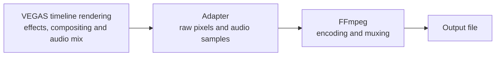

# How the VEGAS adapter receives and encodes media

Updated: 2026-10-10 (Asia/Singapore).

VEGAS supplies rendered, uncompressed video frames and audio samples to the
adapter. P010 is the video memory format used by the current encoded path;
FFV1 is the compression applied afterward.

This explanation describes the implemented baseline and imported research
evidence. **The installed Vegas Encoder DLL now passes one decoded real VEGAS render.**
Earlier observations below retain their predecessor research scope; one successful
product render does not qualify every path. See [status](STATUS.md),
[integration evidence](INTEGRATION_CONTRACT.md) and [source origin](../ORIGIN.md).

## P010, FFV1 and MKV are separate stages

- **P010** stores 10-bit YUV/YCbCr with 4:2:0 chroma sampling. Each pixel has
  a brightness sample; each 2×2 block shares a pair of color samples. Memory
  contains a brightness plane followed by interleaved U/V samples. Each sample
  occupies 16 bits, with the 10 meaningful bits in the high bits.
- **FFV1** compresses video losslessly: decoding reproduces the pixel sample
  values supplied to the encoder. The current command accepts `p010le` and
  selects `yuv420p10le` for FFV1, rearranging the samples into separate Y/U/V
  planes while retaining their 10-bit values.
- **MKV (Matroska)** is the current output container. It holds FFV1 video and,
  when enabled, uncompressed PCM float32 audio.

Format references: [Microsoft's YUV format definition](https://learn.microsoft.com/en-us/windows/win32/medfound/10-bit-and-16-bit-yuv-video-formats),
[FFV1 specification](https://ffmpeg.org/~michael/ffv1.html) and
[FFmpeg pixel formats](https://ffmpeg.org/doxygen/trunk/pixfmt_8h_source.html).
These are reference links retained from the supplied explanation; they were not
re-fetched for this documentation-only task.

**Lossless applies to the pixels received from VEGAS.** If VEGAS converts a
higher-precision or full-color-resolution render into 10-bit 4:2:0 first, FFV1
preserves that converted result. It cannot restore precision or color detail
lost before the adapter received it.

FFV1 provides an initial transport that can be checked by decoding and comparing
samples. It is the current fixed profile, not a permanent product restriction.
See [encoding baseline](ENCODING_BASELINE.md).

## Native readers and buffer ownership

The exporter DLL runs inside the VEGAS process. VEGAS supplies video/audio reader
interfaces and the selected render-template settings. During rendering:

1. The adapter requests video frame **N** using `GetRenderFrame`.
2. The reader returns a memory token identifying accessible pixel data, a
   frame-lock identifier, a byte count and a frame-description structure.
3. The adapter validates and copies the pixels into owned storage, then calls
   `ReleaseRenderFrame` before transport waits.
4. For audio, the adapter supplies a buffer and requests sample frames starting
   at a particular sample position. VEGAS fills it and reports the returned
   count. Valid short reads and final data returned with `S_FALSE` are consumed.
5. The encoding engine sends owned media buffers to an external FFmpeg process
   through separate video and audio named pipes.

Host reader and progress calls stay on Render's caller thread. Pipe writers do
not retain borrowed host-frame pointers. The native evidence is summarized by
F-030/F-031, F-036/F-038 and F-041; F-048 covers the inherited encoding
implementation, and F-050/F-052 cover predecessor real-host observations.

For scale, a tightly packed 1920×1080 P010 frame occupies **6,220,800 bytes**
(about 6.22 MB). At 30 fps, that is **186,624,000 bytes/s**, about 187 MB/s of
raw video before encoding. Delivered strides/padding can increase the host
buffer size; the encoded path validates and packs the frame.

The current audio profile accepts **32-bit floating-point, 48 kHz stereo**.
Each audio sample frame contains a left/right pair: eight bytes.

## Input formats and the current support boundary

The render template specifies a requested pixel format. VEGAS fills in
project-dependent settings during template conformance. A requested format
does not by itself prove a delivered layout or product support.

| Format | Meaning | Evidence/support |
| --- | --- | --- |
| P010 | 10-bit 4:2:0 YUV | Delivered through the research exporter; current product encoded profile, checked with synthetic/fake-host media |
| BI_RGB / BGRA | 8-bit RGB components in four-byte pixels | Research raw-export observations, including bottom-up rows; raw diagnostic path is distinct from encoded support |
| I420 | 8-bit 4:2:0 YUV | Observed in Voukoder templates in the investigation; product delivery/layout validation remains |
| A410 | Reference preset describes 10-bit 4:4:4 plus alpha | Observed in investigation templates; delivered layout and product support remain unvalidated |

The P010 restriction is an implementation choice. It does not establish that
VEGAS can only deliver P010, and a complete supported-format list is unknown.
The template-only observations above are research context, not additional
qualified formats in the product's integration contract.

## Descriptive information, timing and control

| Category | Information represented by the recovered subset |
| --- | --- |
| Video | Dimensions, pixel format, frame index, byte count, plane strides/offsets, frame rate and pixel aspect ratio |
| Audio | Sample representation, sample rate, channel count, bytes per sample frame and total sample count |
| Timing | Video frame count, stream duration and audio sample positions/counts |
| Template | Preset identifiers, name/notes, requested formats and plug-in-private settings bytes |
| Control | Progress interface, cancellation signals and HRESULT success/error results |

These fields remain subject to the measured layouts, token modes and supported
input limits described in the integration contract. Unknown native fields must
remain unknown rather than being assigned inferred semantics.

VEGAS also supplies a metadata-reader interface, but useful metadata has not been
mapped or consumed by this baseline. Color primaries, transfer function, YUV
matrix, HDR mastering information and other metadata need further investigation.
**P010 alone does not identify those characteristics.** General color/HDR/alpha
support is not qualified.

Synchronization uses the **actual delivered stream/frame rate**. F-041 found
cases where it differed from the template's nominal rate. Audio scheduling uses
cumulative rational sample endpoints; container timestamps are checked within
Matroska's time-base resolution in the generated fixtures.
