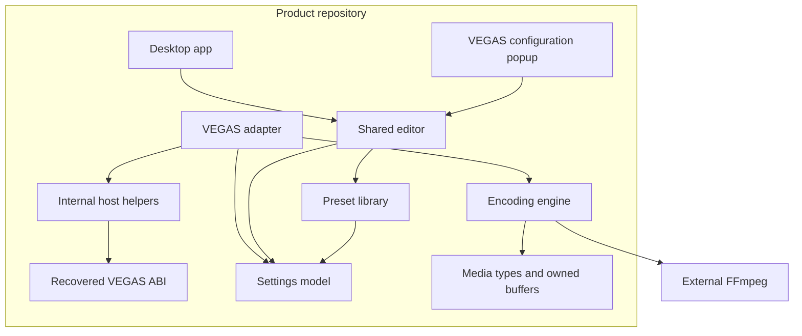

# Vegas Encoder architecture

Updated: 2026-10-10 (Asia/Singapore). Direction: user-requested product with an
internal VEGAS adapter. Implementation details below are a draft for review.

Read the [adapter implementation plan](ADAPTER_PLAN.md)
next. [STATUS.md](STATUS.md) records what actually works today;
[INTEGRATION_CONTRACT.md](INTEGRATION_CONTRACT.md) records native evidence. This document
describes intended architecture, not additional runtime compatibility.

## 1. Goal and immediate focus

Build the user's own encoding product, beginning with a reliable VEGAS Pro
Render As exporter that delivers timeline video/audio to an external FFmpeg
without a signpost AVI. Eventually support reusable presets, detailed editing,
a basic view, a desktop configuration app, and a configuration popup reached
from VEGAS, similar to the user's Voukoder workflow.

**Build the internal VEGAS adapter first. Postpone a separately maintained SDK.**
The recovered interfaces and host helpers are still needed, but initially serve
one product and can evolve with it. Public SDK packaging, developer examples,
general-purpose integration, and API stability are outside the immediate work.

The first target remains Boris FX VEGAS Pro 2026.0.3, executable 2026.0.3.189,
x64. Use the exact path and fingerprint in [TARGET.md](TARGET.md). The adapter
is a native FileIO exporter; it does not establish general external control of
VEGAS projects, events, tracks, or the timeline.

## 2. Two repositories total

Use sibling repositories, each with its own Git history:

```text
L:\repos\
├── vegas-ffmpeg-frameserver\   existing investigation
└── vegas-encoder\            Vegas Encoder product
```

The product repository contains the adapter, encoding engine, presets, desktop
app, popup UI, installer, and product tests. The adapter is a module within that
repository. It has no separate repository or independently released SDK dependency.

The user created this product repository and named it Vegas Encoder. The initial
source import is implemented here; actual gate status is recorded in STATUS.md.

| Repository | Owns | Relationship |
| --- | --- | --- |
| Investigation | Findings, experiments, binary analysis, probes, raw evidence, historical prototypes | Source of integration evidence and future targeted research |
| Product | Production adapter and host helpers, encoding engine, settings, preset library, both UI entry points, installation and product validation | Builds and runs independently of the investigation checkout |

No nested Git repositories are needed. The product does not depend on the
investigation as a submodule or fetch application binaries from it during builds.

## 3. Internal module boundaries

Proposed product layout; names may change during review:

```text
src/
├── vegas/
│   ├── abi/          recovered native declarations and evidence annotations
│   ├── host/         stream, template, allocator and lifetime helpers
│   └── adapter/      exporter entry points and product render coordination
├── media/            plain media descriptions, rates and owned buffers
├── engine/           FFmpeg process, transport, jobs and cancellation
├── settings/         shared settings model, validation and serialization
├── presets/          preset library, revisions and migration
└── ui/               shared editor, desktop and VEGAS popup entry points
tests/
├── vegas/            fake host and native integration checks
└── engine/           transport and decoded-output checks
scripts/              builds, checks and reversible installation
docs/                 architecture, integration evidence and support matrix
```



Arrows denote code dependencies. The adapter also supplies owned media buffers
to the engine at runtime. Both UI entry points edit the same settings model.

| Module | Responsibility | Boundary rule |
| --- | --- | --- |
| `vegas/abi` | Interface IDs, native method shapes, measured layouts and unknown-field annotations | Preserve finding references; do not invent missing native definitions |
| `vegas/host` | Checked template access, host allocation, COM references, frame leases and supported stream access | No encoder options, preset-library policy or product UI controls |
| `vegas/adapter` | Exporter identity, discovery, templates, readers, render scheduling, progress and product error translation | Sole bridge between native host integration and product behavior |
| `media` | Frame/sample descriptions, rational timing and owned storage | No VEGAS interfaces or borrowed host pointers |
| `engine` | Encoder process and pipes, bounded queues, exit checking, final output and cleanup | No VEGAS headers; Windows-specific transport is acceptable initially |
| `settings` / `presets` | Encoding choices, validation, saved recipes and migrations | No dependency on VEGAS template layouts |
| `ui` | Basic/advanced editor and desktop/popup presentation | Share settings and validation; avoid separate configuration logic |

Keep host helpers as an internal source/static library initially. This creates
no additional SDK DLL or public ABI. Internal APIs can change in the same product
change that updates their callers. Avoid implementing a generic plug-in framework
before the real adapter needs it.

## 4. What belongs to the host and to the product

VEGAS provides rendered timeline streams and its native render-template workflow.
The adapter requests supported input formats, validates what actually arrives,
acquires/releases buffers, translates progress/cancel, and coordinates the job.

The product owns encoding recipes, encoder-specific options, processing choices,
the preset library, executable selection, logs, output publication and UI behavior.
Any scaling, frame-rate conversion, filtering or muxing policy added later belongs
to that product layer and must state its relationship to the host-delivered media.

For the first adapter baseline, retain the fixed P010/float-stereo lossless MKV
path from F-048/F-050. Initial success does not require a codec catalog, graphs,
hardware encoding, a desktop framework, or a rich configurator.

## 5. Two preset layers, one settings model

The product should have these distinct objects:

| Object | Contents | Saved by |
| --- | --- | --- |
| Product recipe | Versioned encoding settings, stable preset identifier, revision, name and notes | Product preset library / desktop app |
| VEGAS template configuration | A copy of the recipe settings, origin identifier/revision, local changes and VEGAS-facing render preferences | VEGAS template workflow through the adapter |
| Resolved render job | Immutable settings plus actual delivered media description, destination and current machine configuration | Created per render; diagnostic record |

**Selecting a library preset copies its settings into the template.** After local
edits, save the complete edited snapshot. The origin identifier/revision records
where it came from; rendering uses the snapshot without looking up the library.

Consequences and intended behavior:

- Editing, renaming or deleting a library preset leaves saved VEGAS templates usable.
- Local popup edits change the template; changing the library requires an explicit
  save-to-library action.
- An explicit update-from-library action previews/replaces settings. No automatic
  link to the latest recipe revision is enabled initially.
- Basic and advanced views edit one settings object. Switching views preserves
  advanced values rather than recreating a preset from visible basic fields.
- Persist project-relative choices such as "follow project" as choices. Resolve
  them against the host source for a render; record the delivered format separately.
- Machine preferences, including the local FFmpeg executable path, remain separate
  from portable recipe settings. Record encoder identity with the job.

Use a versioned product payload in the template's private settings region if the
native persistence experiment establishes that it survives editing, conformance,
save/reload and Create. Exact encoding and payload limits remain to be measured.
Do not persist C++ pointers, object layouts or machine handles.

This is a product design proposal. F-033/F-036 establish the observed `abExtra`
region; they do not prove our future save/reload implementation. The adapter plan
has a dedicated persistence gate before rich preset work.

VEGAS documents its custom-template workflow and copying saved `.sft2` templates.
That supports the intended user flow, not the reconstructed native settings ABI.
[VEGAS 2026 custom rendering templates](https://cdn.borisfx.com/borisfx/Documentation/vegas/2026/en/content/topics/10-export/render_templates.htm)

## 6. Desktop app and VEGAS popup

The desktop app manages library presets and application preferences. The VEGAS
popup selects a library recipe and edits the current template configuration.
Both should use shared editor and validation logic.

First prove a small native configuration page. Decide how to host the richer
shared editor after the native lifetime, parenting, Apply/Cancel and persistence
behavior is understood. An in-process editor and a separately launched helper
are possible implementations; neither is a requirement of the initial adapter.

If a helper is later chosen, use a versioned control protocol with bounded waits,
transactional settings transfer and clear cancel/error behavior. Keep frame/sample
transport in the encoding path. The standalone desktop app should not need to be
running for a saved template to render.

## 7. Connect the repositories through provenance

At extraction, create the product's `ORIGIN.md` with the investigation path/URL
when available, source revision, import date, source-to-destination file map,
finding references and per-file SHA-256 values. Current production-candidate work
includes uncommitted files, so HEAD alone cannot identify the imported baseline.
Preserve a manifest and patch or source snapshot covering those exact bytes.

Copy practical native contract notes and reproducible fixtures/checkers that the
product needs. It must be possible to build and validate the product with its own
checkout and documented development tools. Raw captures, installed payloads,
decompiler databases and third-party connector binaries remain ignored research
inputs; the product must not require those payloads to compile or run fake tests.

After extraction, maintain production implementation in the product. Preserve
this repository's prototype as its historical baseline. New native questions can
be investigated here; verified findings feed product fixes with provenance.
Avoid maintaining two competing production implementations.

Add reciprocal README links once real repository locations or URLs exist. Do not
invent remote links. Review attribution and source origin when importing; project
licenses remain undecided and no source license conclusion is made by this plan.

## 8. Foundation order and review decisions

1. Review this architecture and the detailed adapter milestones.
2. Qualify the current FFmpeg baseline sufficiently to compare an extraction.
3. Create the product repository and import the exact selected baseline.
4. Separate ABI, host helpers, adapter and engine with unchanged initial behavior.
5. Validate the extracted product in a fake host and on the exact real host.
6. Prove one configurable setting survives template save/restart/render.
7. Build the shared settings/preset/editor foundation; expand formats and features
   only with corresponding qualification.

Repository skeleton/provenance work can proceed before all long-duration tests.
Do not declare extraction parity until repeat/cancel/error behavior has a real
baseline, or declare a release qualified while the broader Phase 3 gate is open.

Review items: product plug-in identity/migration policy; development plug-in identity; old-template
migration policy; initial supported format/rate matrix; native page versus helper
hosting after the small proof; FFmpeg distribution and project licenses. These
choices do not require creating a public SDK.

## 9. Reconsidering an SDK later

Revisit a third sibling repository when a second exporter needs this integration,
another developer becomes an actual consumer, or the integration is stable enough
to document and support independently. Candidate extraction is `vegas/abi` and
reusable parts of `vegas/host`. Product-specific adapter, encoding policy, presets
and UI remain with the product.

An SDK is a future option, not a prerequisite or a scheduled deliverable now.
