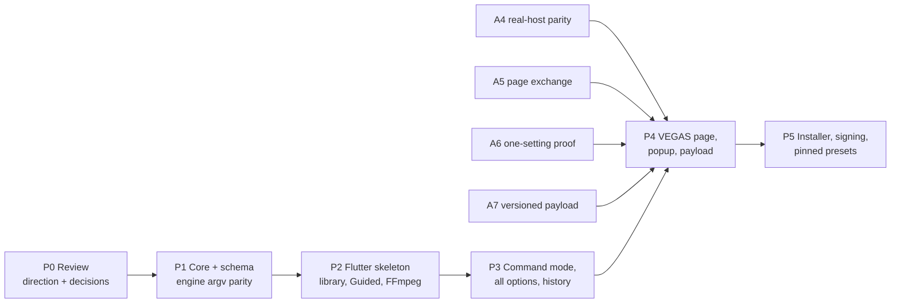

# Product roadmap

Updated: 2026-10-11 (Asia/Singapore). Status: proposal.

The product phases run alongside the adapter gates in [ADAPTER_PLAN.md](../ADAPTER_PLAN.md);
gate state is tracked in [STATUS.md](../STATUS.md). No calendar estimates are given,
for the same reason as ADAPTER_PLAN §7: real-host access and native-exchange recovery
set the pace.

Each phase is a reviewable change. It gets its own experiment note and evidence,
and STATUS is updated at the end.

## P0: Review (now)

- Choose a design direction, or a mix (see [design/index.html](design/index.html)).
- Confirm or adjust the decisions in [README.md](README.md#decisions-for-the-owner).
- **Exit:** a chosen direction with a list of changes, and accepted T1–T8 decisions in TECH_ARCHITECTURE §1.

## P1: Product core and schema (no VEGAS, no Flutter)

1. Write `schema/recipe.v1.schema.json` and `schema/encoder-profiles.v1.json` from the
   prototype data in `design/shared/model.js`. Encoder option facts come from the
   captured help text; container rules come from the matrix.
2. Add `src/core`: normalize, validate, compile, lint, payload envelope, session formats
   and the C ABI. C++17, no Windows or VEGAS headers.
3. Golden fixtures. Every built-in preset plus edge cases (template mode, missing
   macros, unknown encoder, ProRes 4444, DNxHR pixel format, CBR in MP4) map to
   expected argv. The compile path for the current fixed profile must reproduce the
   existing FFV1/PCM command.
4. Engine change: accept argv plus input specs instead of the fixed profile. Add
   `-progress pipe:1` parsing and ffprobe output verification before publish.
5. Extend the fake-host suite to render several compiled recipes through FFmpeg
   (x264/MP4, ProRes/MOV, FFV1/MKV), decode them, and run the existing checkers where
   they apply.

**Exit:**
- Core tests pass on Linux and Windows.
- Fake-host suite passes with recipes.
- Fixed-profile decoded output is unchanged.
- Measured compile time is recorded.
- No real VEGAS claim.

## P2: Flutter skeleton

1. `app/` on Flutter 3.47. Core is built through build hooks, with the CMake fallback if
   the C++ spike fails. Run the TECH_ARCHITECTURE §9.4 Windows spikes:
   - start time;
   - console flash;
   - owner HWND;
   - renderer;
   - file watching.
2. Design system from the chosen direction's tokens (`ThemeExtension`). Components:
   - encoder picker with availability;
   - mode switch;
   - quality control;
   - command preview;
   - message list.
3. Presets: library repository (files, revisions, watch); built-ins; list, search,
   favorites; duplicate, save, import/export.
4. Guided editor for every curated encoder; live command, validation and estimate via FFI.
5. FFmpeg page: discovery, identity, probe, cache, hardware tests; the default is written
   to `machine.json`.
6. Linux development build and golden screenshots of each screen.

**Exit:**
- Windows release build measured against the §9.3 budgets.
- Golden tests pass.
- Presets round-trip through core.

## P3: Command mode, all options, history

1. Command editor:
   - highlighting;
   - locked macro chips;
   - lint in place;
   - autocomplete from parsed options;
   - seed from Guided and switch back.
2. "All options" with typed editors and changed-value marks; cross-setting search.
3. History from `jobs.jsonl` and job records: detail, stderr, command, verification,
   and "open settings as new preset".

**Exit:** Command-mode recipes compile and render in the fake host, and lint fixtures pass.

## P4: VEGAS integration (gated)

**Prerequisites:**

- A4: the product DLL is qualified on the exact host.
- A5: the page exchange is recovered.
- A6: one setting persists across save and restart.

1. Native property page: summary, Edit settings…, Load preset; and the open-editor state
   (mock: `design/shared/vegas-native-page.html`).
2. Session protocol v1 and popup mode: owner, modality, crash-safe result, Apply/Cancel.
3. A7 payload envelope in `abExtra`. Measure the size limit. Migrate legacy markers if
   that is accepted.
4. The render path uses the template's recipe:
   - "follow project" choices resolved;
   - errors before render for missing or failed encoders;
   - job records.
5. Real-host checklist on 2026.0.3.189:
   - render each qualified recipe;
   - repeat, cancel and failure renders;
   - two templates, unapplied cancel, save and restart;
   - recipe edited or deleted in the library, with the template still rendering;
   - editor crash recovery;
   - owner and focus behaviour.
6. Publish the first **qualified matrix**, for example x264/MP4, NVENC HEVC/MP4,
   ProRes/MOV and FFV1/MKV with AAC/PCM, each with evidence.

**Exit:**
- ADAPTER_PLAN A8 foundation checklist complete.
- Popup checklist passes.
- Exact identities and hashes recorded.

## P5: Release foundations

1. Signed installer with reversible plug-in placement, upgrade policy that preserves
   config, and uninstall.
2. Research gate: pinned presets as exporter presets (Render As list caching, F-044).
3. Optional "Get FFmpeg" helper, once licensing is decided.
4. Update checks and crash/diagnostic bundle export, opt-in.

## Risks

| Risk | Effect | Mitigation |
| --- | --- | --- |
| A5 can't recover the template exchange | No in-VEGAS editing | Pinned presets in Render As (§5.5 fallback); edit in the desktop app |
| `abExtra` size limit is small | Snapshot doesn't fit | Compact encoding or compression; drop optional fields such as notes; measure first |
| VEGAS names output files by class extension (`*.mkv`) | Wrong extension for MP4/MOV | Investigate per-template extensions; engine renames on publish if needed (to verify) |
| Cross-process owner window misbehaves in VEGAS | Editor hides behind VEGAS or steals focus | P2 spike; fall back to an unowned topmost window with a native page reminder |
| Flutter cold start too slow for the popup | Sluggish feel | Measure; pre-warm on page creation (spawn hidden, then show) as a v2 option |
| Encoder behaviour differs across FFmpeg builds | Lint or compile mismatches | Capability cache per build; fixtures from Windows builds; FFmpeg stderr is authoritative |
