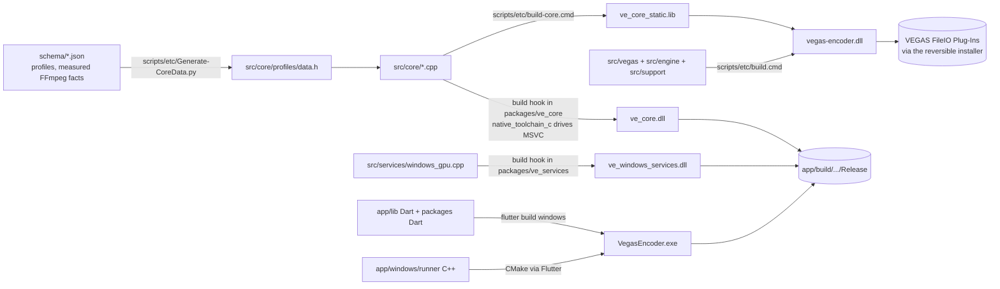
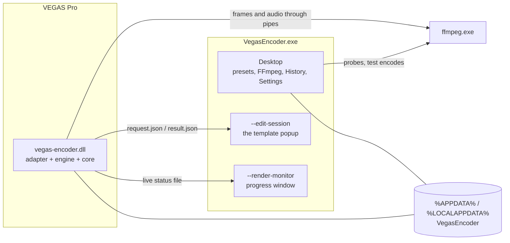

# System overview: what is built, in what, and how it fits

Updated: 2026-10-17 (Asia/Singapore). App and platform now have one agent in the
original `L:\repos\vegas-encoder` checkout, on `master`.
See [workflow](WORKSTREAMS.md) and the current [queue](../NEXT_AGENT.md).
This describes the system
**as built**: the languages, the folders, how each part becomes a binary and how the
parts talk at run time. The design reasons and the original plan are in
[TECH_ARCHITECTURE.md](TECH_ARCHITECTURE.md); exact data shapes are in
[CONTRACTS.md](CONTRACTS.md); current qualification is in [STATUS.md](../STATUS.md).

## In one paragraph

Vegas Encoder is a VEGAS Pro **exporter plug-in** (a C++ DLL loaded by VEGAS) plus a
**desktop app** (`VegasEncoder.exe`, Flutter) for presets, FFmpeg setup and the editor.
The rules for turning settings into an FFmpeg command live once, in a portable **C++
core** (`src/core`). That core is compiled twice from the same sources: statically into
the exporter DLL, and as `ve_core.dll` for the app. The app reaches it through a thin
Dart package (`packages/ve_core`), and reaches files and processes (FFmpeg, the preset
library, settings) through a second Dart package (`packages/ve_services`). The app
itself is the user interface: it shows what the core and the services report.

## Tech stack

| Part | Language and tools | Runs as |
| --- | --- | --- |
| Product core (`src/core`) | C++17, MSVC (`/W4 /WX`), nlohmann/json (MIT, vendored), a C ABI | `ve_core.dll` (app) and `ve_core_static.lib` (exporter) |
| Exporter (`src/vegas`, `src/engine`, `src/support`) | C++17, MSVC, Win32/COM | `vegas-encoder.dll`, loaded by VEGAS Pro 2026 |
| Windows helper (`src/services`) | C++17, DXGI | `ve_windows_services.dll` (GPU and driver identity) |
| Core package (`packages/ve_core`) | Dart 3.13, `dart:ffi`, Dart build hooks (`native_toolchain_c`) | Part of the app |
| Services package (`packages/ve_services`) | Dart 3.13, `dart:io` (files, processes), `crypto`, a build hook for the helper | Part of the app |
| App (`app/`) | Flutter 3.47.7, Dart 3.13, Riverpod 3.4; its own components (not Material); C++ Windows runner | `VegasEncoder.exe` |
| Data (`schema/`) | JSON: recipe schema, encoder profiles, measured Windows FFmpeg facts, fixtures | Generated into the core |
| Scripts (`scripts/`) | Windows batch (builds), PowerShell (test runners, installer), Python (data generation, checks) | Developer machine |
| Tests (`tests/`, package and app `test/`) | C++ test programs and a fake VEGAS host; Dart `test`; Flutter widget and golden tests | Developer machine |

Windows x64 only. No Rust, no web stack and no other UI toolkit; the only third-party
Dart packages are Riverpod and the Dart team's build-hook and FFI packages.

## Repository map

| Folder | What it is | Language | Becomes | Maintainer |
| --- | --- | --- | --- | --- |
| `src/core/` | Recipe rules: normalize, validate, compile to FFmpeg arguments, lint and completion for Advanced mode, size estimates, diff, template payload. `capi/ve_core.h` is its C ABI; `profiles/data.h` is the generated encoder and container catalog. No Windows or VEGAS headers | C++17 | `ve_core.dll`, `ve_core_static.lib` | Unified agent |
| `src/vegas/` | The VEGAS side: recovered host interface declarations (`abi/`), template and frame helpers (`host/`), the exporter's entry points and render path (`adapter/`), the template page and editor-session transport (`configuration/`) | C++17 | `vegas-encoder.dll` | Unified agent |
| `src/engine/` | Runs FFmpeg for a render: pipes for VEGAS's frames and audio, progress parsing, the live status file, output checks with ffprobe, job records | C++17 | `vegas-encoder.dll` | Unified agent |
| `src/services/` | `windows_gpu.cpp`: reads the GPU and driver identity for hardware-test caching | C++17 | `ve_windows_services.dll` | Unified agent |
| `src/support/`, `src/settings/` | Diagnostics, exception boundaries, developer settings | C++17 | `vegas-encoder.dll` | Unified agent |
| `packages/ve_core/` | The app's door to the core: typed models (`Recipe`, `CompileResult`, `Issue`…), `NativeVeCore` (FFI calls), `FakeVeCore` (fixed answers for tests) and the build hook that compiles `src/core` | Dart | Linked into the app; builds `ve_core.dll` | Unified agent |
| `packages/ve_services/` | The app's door to the system: FFmpeg discovery, probing, help-text parsing, hardware test encodes, capability cache, preset library files, machine settings, job records, live render status, edit sessions; a fake for each | Dart | Linked into the app; builds `ve_windows_services.dll` | Unified agent |
| `app/lib/` | Screens (`features/`), state (`state/`, Riverpod), design system (`design/`), window channel (`platform/`) | Dart (Flutter) | `VegasEncoder.exe` (AOT) | Unified agent |
| `app/windows/runner/` | The Windows host for Flutter: caption-less window, popup ownership and placement, no-activate progress window, single instance, file dialog | C++ | Part of `VegasEncoder.exe` | Unified agent |
| `app/test/`, `app/tool/` | Widget, unit and golden tests; window spike harness; budget measurements | Dart, C# (spike probe) | — | Unified agent |
| `schema/` | Recipe schema, encoder profiles, measured FFmpeg data per Windows build, fixtures shared by C++ and Dart tests | JSON | Input to `profiles/data.h` and tests | Unified agent |
| `tests/` | Core tests, VEGAS helper tests, engine tests with recipes, `fiohost` (a fake VEGAS host that drives the real exporter DLL) | C++ | Test executables | Unified agent |
| `scripts/` | `build.cmd` (exporter), `build-core.cmd`, generators, test runners, the reversible installer | Batch, PowerShell, Python | — | Unified agent |
| `config/` | Development INI copied beside the exporter DLL | INI | — | Unified agent |
| `docs/` | Adapter and qualification documents; `docs/product/` holds the product plan, contracts, UI spec and workstream files | Markdown | — | Unified agent; owner decisions |

## How each part is built

- **The app.** `flutter build windows --release` (or `flutter test`) compiles the Dart
  code ahead of time and the C++ runner through CMake. Because the app depends on the two
  packages, Flutter runs their **build hooks** first: small Dart programs
  (`packages/*/hook/build.dart`) that call MSVC through `native_toolchain_c` to compile
  `src/core/*.cpp` into `ve_core.dll` and `src/services/windows_gpu.cpp` into
  `ve_windows_services.dll`. Flutter then places both DLLs beside `VegasEncoder.exe`
  ("native assets"). So the C++ core is built as part of the Flutter build; nothing else
  needs to run first.
- **The exporter.** `scripts/etc/build.cmd` compiles the core into `ve_core_static.lib`
  (`build-core.cmd`), compiles the VEGAS adapter, engine and support code, and links them
  into `build/vegas-encoder/vegas-encoder.dll` with its INI. It also builds the fake host
  and helper tests. The installer script copies the DLL into VEGAS's plug-in folder,
  reversibly; that is only done with the owner.
- **The catalog.** `src/core/profiles/data.h` is generated from `schema/` by
  `scripts/etc/Generate-CoreData.py`. It holds what each encoder offers (rate modes, quality
  ranges and their marks, speed presets, tunes, profiles, bit depths), the containers and
  which codecs each can hold, measured from real Windows FFmpeg builds (B1).

## How the parts talk at run time

### The app and the core

The core's C ABI (`src/core/capi/ve_core.h`) is a handful of functions that each take
UTF-8 JSON and return UTF-8 JSON in a buffer the caller frees with `ve_free`:
`ve_profiles`, `ve_recipe_normalize`, `ve_recipe_validate`, `ve_compile`,
`ve_template_lint`, `ve_template_complete`, `ve_estimate`, `ve_recipe_diff`, the payload
and session checks. `packages/ve_core` wraps them: `NativeVeCore` (hand-written
`dart:ffi` bindings in `native_bindings.dart`) turns Dart models into JSON, calls the
function and turns the answer back into models. Calls are synchronous and isolate-local.

An edit in the app goes like this:

1. A control changes a field of the recipe (the preset's settings, a JSON document).
2. The editor state asks the core to compile it, with the media it previews against and
   what the chosen FFmpeg can do (a capability view from the services).
3. The core returns the exact FFmpeg arguments, the command as display tokens (each
   linked to the setting that produced it), the checks (each with its setting and the
   tokens it points at), the signal-path facts (bit depth, pixel-format conversions,
   whether the container can hold each stream) and a summary.
4. The screens redraw from that: the command column, Checks, the diagram, the read-outs.

That round trip takes about 3–4 ms on this PC with real capability data (the §9.3 budget
is 4 ms). Advanced mode adds lint and completion calls; it is slower today (25–32 ms per
keystroke) because each call sends the full capability map, which platform is fixing.

### The app and the system

`packages/ve_services` does everything that touches files or processes, in Dart:

| Service | What it does |
| --- | --- |
| FFmpeg discovery and probe | Finds installations (PATH, WinGet, Scoop, Chocolatey, added by hand), identifies them by file hash, runs `ffmpeg -encoders`, `-muxers` and `-h encoder=…` without a console window, parses the help text |
| Hardware tests | Encodes one small frame with each GPU encoder (NVENC, QSV, AMF…) to see whether it really works on this PC; caches the result per FFmpeg build and GPU driver |
| Capability cache | Stores what each installation can do, so the editor's checks don't run FFmpeg |
| Preset library | One `.vepreset` file per preset under `%APPDATA%\VegasEncoder\library`, with revisions and history; built-in presets are packaged |
| Machine settings | `%APPDATA%\VegasEncoder\machine.json`: default FFmpeg, progress-window options, theme, window bounds |
| Jobs and live status | Render records and the live progress file under `%LOCALAPPDATA%\VegasEncoder\jobs` |
| Edit sessions | The popup's `request.json` and `result.json` |

The app builds all of these once (`servicesProvider`, from the platform's
`WindowsServices`); tests swap in the fakes. `VEGAS_ENCODER_DATA_ROOT` moves the data
folders for development.

### VEGAS, the exporter and the app

One executable has three modes, chosen by its command line: the desktop app, the popup
(`--edit-session <folder>`, owned by VEGAS's template dialog) and the progress window
(`--render-monitor <file>`). The exporter and the app never share memory; they meet in
files whose shapes are fixed in CONTRACTS.md:

| Contract | Between | Carries |
| --- | --- | --- |
| C1 | Core, app, exporter | The recipe (a preset's settings) and the encoder catalog |
| C2 | App and core | The core's API (compile, checks, lint, estimates, diff…) |
| C3 | App and services | The service APIs and their fakes |
| C4 | Exporter and popup | `request.json` (the template, its origin, VEGAS's project facts, the owner window) and `result.json` (apply or cancel) |
| C5 | Exporter and progress window | The live render status file |
| C6 | Exporter and History | Job records and `jobs.jsonl` |
| C7 | App and exporter | `machine.json` |

## Who decides what

| What you see | Where it comes from |
| --- | --- |
| Which controls an encoder has, their ranges, marks ("CRF 18, high quality") and choices | The core's catalog (`profiles/data.h`, from measured FFmpeg data) |
| The FFmpeg command, and which control produced each part of it | The core (`compile`) |
| Checks and errors ("x264 isn't in FFmpeg 8.0 LGPL", "Extra arguments can't choose the encoder") | The core, given what the services found in that FFmpeg |
| Ready / Not in this FFmpeg / Failed test | The services' probe and hardware test encodes |
| Bit-depth wires, conversion pips, "can't mux" | The core's signal-path facts |
| Size estimates | The core |
| Highlighting, lint and suggestions in Advanced mode | The core |
| Differences between a template and its preset | The core (`diff`) |
| Layout, screens, wording, keyboard, theme, dialogs, what happens on Save or Apply | The app |

The app holds no codec rules and never parses or builds an FFmpeg command itself; where
the core gives no fact, the app shows less and asks platform for it (app.md, Needs).

## What is connected today

- **Working now:** the desktop app on the real core and the real services: the preset
  library, the Basic and Advanced editors, FFmpeg discovery and checks, History, Settings.
  The native template page launches the popup through C4, stores complete snapshots,
  renders from them and launches the progress window independently of Render.
- **Installed owner trial:** 0.1.7 template-name-fix on VEGAS 2026.0.3.189, with
  recipe rendering and owner-confirmed behavior at STATUS's recorded scope. Current
  source changes have not replaced that installation. Older statements that B6 is
  entirely unconnected are superseded; remaining qualification is explicit in STATUS.
- **Current container source:** five-container shared preflight/engine/preview
  paths pass offline checks; writer extension advertising still returns `*.mkv`.
  Naming/filter/default behavior and new-container real-host checks remain.
- **Remaining product features:** finish native MP4/MOV/WebM/MXF support alongside
  MKV, and add a read-only VEGAS installation/status dashboard. The owner makes the
  installer. Other unfinished enhancements are skipped for this release; preserve
  existing history/conflict, snapshot/diff, log and sample-fallback plumbing. See
  [current scope](PRODUCT_SPEC.md#current-release-scope-owner-2026-10-17).

## Tests, by layer

| Layer | Tests | Command |
| --- | --- | --- |
| Core | `tests/core/core_tests.cpp`, C ABI header checks, recipe-to-argv fixtures | `scripts/etc/Test-CoreNative.cmd`, `scripts/etc/Test-B2.ps1` |
| Exporter and engine | `tests/fiohost` (fake VEGAS host driving the real DLL), `tests/host`, `tests/engine` | `scripts/etc/build.cmd`, `scripts/etc/Test-VegasEncoder.ps1`, `scripts/etc/Test-B4.ps1` |
| Dart packages | `packages/*/test` (models, fakes, real files and processes on temporary folders) | `dart test` in each package, `scripts/etc/Test-B3*.ps1` |
| App | `app/test`: unit, widget and golden tests (light and dark), mostly on the fakes, the native core where results matter | `flutter test` in `app/` |
| App windows | Start time, popup ownership, the no-activate progress window, against a fake VEGAS window | `app/tool/spikes/run_window_spikes.ps1` |
| Real VEGAS | Gated checks with the owner on the exact target build | [VEGAS_RUNTIME.md](../VEGAS_RUNTIME.md) |

## Where to read next

- Why it is split this way: [TECH_ARCHITECTURE.md](TECH_ARCHITECTURE.md) (its layout
  section is the plan; this file is what was built). Since that plan, the app dropped
  freezed, package:win32 and window_manager: window work is in the C++ runner behind a
  method channel, and the FFI bindings are hand-written rather than generated.
- Unified ownership, working location and retained trial artifacts: [WORKSTREAMS.md](WORKSTREAMS.md).
- The settings model and command rules: [SETTINGS_AND_COMMANDS.md](SETTINGS_AND_COMMANDS.md).
- The exporter's side: [ARCHITECTURE.md](../ARCHITECTURE.md), [ADAPTER_PLAN.md](../ADAPTER_PLAN.md).
- Current progress/queue: [STATUS.md](../STATUS.md), [NEXT_AGENT.md](../NEXT_AGENT.md).
  Historical component records: [app](workstreams/app.md), [platform](workstreams/platform.md).
