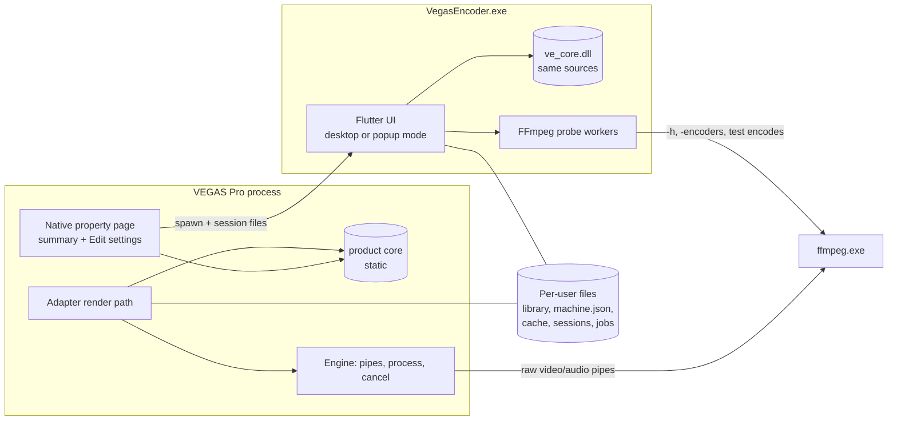

# Vegas Encoder product architecture

Updated: 2026-10-16 (Asia/Singapore). Architecture plan with later decisions;
as-built implementation is in SYSTEM_OVERVIEW and qualification in STATUS.
One agent owns app/platform in the original checkout (WORKSTREAMS.md), preserving
layer/process contracts. Flutter and Windows x64 are decided. It extends
[ARCHITECTURE.md](../ARCHITECTURE.md) §3–§6 with the product layer: shared core,
Flutter app, VEGAS popup, presets and FFmpeg management. Those components are built;
recorded real-host checks do not qualify every planned feature. Native exchange (A5), persistence (A6) and
versioned payloads (A7) remain the gates in [ADAPTER_PLAN.md](../ADAPTER_PLAN.md);
designs that depend on them are marked **gated**.

## 1. Decisions in one table

| # | Decision | Recommendation | Why | Alternative kept open |
| --- | --- | --- | --- | --- |
| T1 | Where settings become an FFmpeg command | A portable C++17 **product core** (`src/core`) compiles recipe + delivered media into argv. The DLL links it statically; the Flutter app calls the same code through `dart:ffi`. | One implementation for preview and render. The preview cannot drift from what VEGAS actually runs. | Rust core via flutter_rust_bridge (adds a toolchain for no product gain) |
| T2 | How the editor appears from VEGAS | The DLL's native property page shows a summary and **launches `VegasEncoder.exe` as a separate, owned, modal process**. Exchange uses session files. | Keeps Flutter, its engine DLLs and GPU context out of the VEGAS process. A crash in the editor cannot take VEGAS down. The editor never touches VEGAS memory. | In-process Flutter engine (rejected for v1, §5.4); live pipe protocol (v2 upgrade path) |
| T3 | Template payload | Versioned envelope in the template's private bytes (`abExtra`) holding the **complete recipe snapshot** as canonical UTF-8 JSON. | Matches ARCHITECTURE §5 (snapshot semantics). Debuggable. Forward-migratable. | Binary encoding or compression if A7 measures a tight size limit |
| T4 | FFmpeg used for a render | Machine default from `machine.json`. A recipe never stores a path. The job records the exact executable, version and hash. | Recipes stay portable. Renders stay reproducible and diagnosable. | Per-preset machine-local override (later) |
| T5 | Encoder knowledge | Declarative **encoder profiles** (data) used by both core (compile) and UI (fields). Uncurated encoders get the generic controls; parsed `-h encoder=X` options check Extra arguments and drive Advanced-mode lint and autocomplete. | Adding an encoder is a data change. The UI and the compiler cannot disagree on what a field means. | Hand-written per-encoder widgets |
| T6 | Capabilities | The app probes each FFmpeg installation, caches by content hash and **qualifies hardware encoders with real test encodes**. | "Listed" is not "works on this PC" (NVENC/QSV/AMF failures are routine). | — |
| T7 | Flutter stack | Flutter 3.47 / Dart 3.13. Riverpod 3.4, freezed 4, build hooks + `native_toolchain_c` 0.19 (CMake fallback), package:win32 6.4, window_manager 0.5. No large UI kit and not the Material look: Signal Flow's own components on `ThemeExtension`, light and dark, following the Windows theme. **Decided** by the owner, 2026-10-12. | Current, maintained and testable. Flutter draws every pixel itself, so the diagram, wires and custom controls are ordinary `CustomPainter` and widget work. | A headless kit (such as forui) for base widgets, only after checking its current version |
| T8 | Packaging | One signed installer (Inno Setup or WiX) for the app, DLL and config. Install/uninstall is reversible and manifest-based, as `Install-VegasEncoder.ps1` already does. | MSIX cannot place a plug-in under the VEGAS Program Files folder. | MSIX for the app alone plus a separate plug-in installer |

## 2. Processes and data flow



| Process | Lifetime | Talks to | Never does |
| --- | --- | --- | --- |
| VEGAS + `vegas-encoder.dll` | Host session | Template bytes, host readers, FFmpeg pipes, session files, `machine.json` (read), `jobs.jsonl` (append), live render status file (write, §5.6) | Load Flutter; read the preset library during a render; probe FFmpeg capabilities; wait on the progress window |
| `VegasEncoder.exe` desktop mode | User-started; single instance | Library, machine settings, cache, job logs, FFmpeg probes | Touch VEGAS memory or templates directly |
| `VegasEncoder.exe --edit-session` | One per popup, owned by the VEGAS dialog | One session directory, library (read; write only on explicit Save to library), cache | Outlive its session; render |
| `VegasEncoder.exe --render-monitor` | One per render, if enabled; exits after the render ends | The live status file (read), job record (read) | Take focus; touch FFmpeg, the pipes or VEGAS; slow the render |
| `ffmpeg.exe` | One per render (engine) or per probe (app) | Pipes or `lavfi` test input | — |

Host calls stay on Render's caller thread (existing rule). Session and editor
activity happens on the property page's UI thread and never blocks it (§5.2).

## 3. Repository layout (proposed additions)

```text
src/
├── vegas/…            existing adapter, host helpers, ABI
├── engine/…           existing; gains "run this argv" instead of a fixed profile
├── core/              NEW portable C++17, no Windows or VEGAS headers
│   ├── recipe/        schema v1 types, canonical JSON, validation, migration
│   ├── profiles/      encoder/container profile data (generated header from JSON)
│   ├── compile/       recipe + MediaDescription → argv; macros; template lint
│   ├── payload/       template private-payload envelope
│   ├── session/       pure editor session request/result serialization (no file I/O)
│   ├── machine/       pure machine-setting views; file I/O stays at system edges
│   └── capi/          ve_core.h: C ABI for dart:ffi (UTF-8 JSON in/out)
├── support/…
packages/               NEW pure Dart packages, no Flutter (platform workstream)
├── ve_core/           domain models (Recipe, Preset, Issue, CompileResult…), the VeCore
│                      API over ve_core.dll (ffigen + hook/build.dart), and FakeVeCore
└── ve_services/       FFmpeg discovery, probe, help-text parser, hardware tests, cache;
                       library repository; machine.json; job records and live status;
                       session files. Each service has a fake for UI tests
app/                   NEW Flutter application, Windows x64 only (app workstream)
├── lib/
│   ├── main.dart      mode dispatch: desktop | --edit-session <dir> | --render-monitor <file>
│   ├── state/         Riverpod providers and controllers over ve_core / ve_services
│   ├── features/      presets/, editor/, advanced/, ffmpeg/, history/, settings/, popup/, monitor/
│   └── design/        tokens (ThemeExtension, light and dark), typography, components
├── windows/runner/    owner HWND, single instance, DPI, no-activate show
└── test/              widget and golden tests (light and dark), using the fakes
schema/
├── recipe.v1.schema.json         source of truth for recipe structure
├── encoder-profiles.v1.json      curated encoder knowledge (§6.3)
└── fixtures/                     recipe → expected argv goldens shared by C++ and Dart tests
tests/core/                       C++ tests for compile, validation, payload bounds, migration
```

The product core is the only code shared between the DLL and the app. The engine's
existing rules still apply: no VEGAS headers outside `src/vegas` and owned buffers only.
The core adds a stricter rule: **no Windows headers either**. That keeps it testable on
its own (plain C++ tests and `flutter test`) and keeps platform code at the edges.
Development, tests and CI all run on Windows; there is no Linux target.

## 4. The product core

### 4.1 Responsibilities

| Area | Function (C ABI, JSON in/out) | Used by |
| --- | --- | --- |
| Normalize | `ve_recipe_normalize(json) → {recipe, issues}`: fills defaults, drops nothing unknown, canonical key order | App save/load; DLL payload decode |
| Validate | `ve_recipe_validate(recipe, media?, caps?) → issues[]` | App (live); DLL before render |
| Compile | `ve_compile(recipe, media, paths) → {argv[], display[], issues[]}` | App preview (media = sample or VEGAS context); DLL render (media = delivered) |
| Lint | `ve_template_lint(text, caps?) → diagnostics[]` | App Advanced mode; DLL before render |
| Payload | `ve_payload_encode(recipe, origin) → bytes`, `ve_payload_decode(bytes) → {recipe, origin, migrated}` | DLL template I/O; app tests |
| Session | Pure request/result serialization; file I/O lives in `ve_services` / adapter, outside the core C ABI | DLL property page; app popup mode |
| Profiles | `ve_profiles() → json` | App reads the same encoder knowledge the compiler uses |
| Version | `ve_core_version()`, `ve_schema_max()` | Compatibility checks between app and DLL |

All core functions are pure; session file I/O belongs to `ve_services` and the
adapter. Functions are deterministic and reentrant, and they allocate only through
a `ve_free` paired API. Strings are UTF-8
at the C boundary. The DLL converts paths to wide strings at its own edge.

### 4.2 Why JSON at the boundary

A single JSON shape is used for template payloads, session files, preset files and
FFI calls. That gives one serialization to test. The JSON is small (1–4 KB per
recipe), so FFI cost is negligible compared with a frame: compile is expected well
under 1 ms. This is to be measured in P1 and recorded.

The recipe stores audio as a one-element list in v1. Template/session/job origin is
`{presetId, revision, name}` (or null), separate from the complete recipe snapshot.
Exact boundary shapes, including command provenance and per-stream signal-path
facts returned by compile, are in [CONTRACTS.md](CONTRACTS.md).

Dart sees typed models. C++ sees typed views. The canonical JSON written by core is
the interchange format.

### 4.3 Error model

Validation issues carry a stable ID (`V-VIDEO-ENCODER-MISSING`, `V-CONTAINER-CODEC`…),
a level (`error` blocks Apply/render, `warn` allows it, `info` explains a consequence),
the field path, a message template and an optional fix. The UI owns the wording via
message IDs so copy can change without touching core. Logs record the ID and
parameters. The current mockup wording lives in `design/shared/model.js`.

## 5. VEGAS popup: launching and exchanging settings

### 5.1 Native page (in the DLL) — gated on A5

The exporter reports one property page once A5 establishes the template exchange.
The page is plain Win32 inside VEGAS's Custom Template dialog. It shows:

- a summary of the template's recipe (container, video encoder and quality, audio, warnings);
- origin preset and revision, and "edited in VEGAS" if the template has local changes;
- **Edit settings…** (launches the editor) and **Load preset** (a quick menu of library
  favorites, applied without opening the editor);
- the FFmpeg that renders will use, and its readiness.

Mock: [design/shared/vegas-native-page.html](design/shared/vegas-native-page.html).

### 5.2 Edit session (v1: files and process lifetime)

```mermaid
sequenceDiagram
    participant Page as Native page (VEGAS UI thread)
    participant FS as Session dir
    participant Ed as VegasEncoder.exe --edit-session
    Page->>FS: write request.json (snapshot, origin, context, owner HWND)
    Page->>Ed: CreateProcessW (owner disabled, "Opening editor…")
    Ed->>FS: read request.json
    Note over Ed: user edits; library read-only unless Save to library
    Ed->>FS: write result.json atomically (apply | cancel)
    Ed-->>Page: process exits
    Page->>FS: read + validate result (core)
    Page->>Page: mark page dirty; commit on host Apply (A6)
    Page->>FS: delete session dir
```

- **Session dir:** `%LOCALAPPDATA%\VegasEncoder\sessions\<uuid>\`, created per edit
  with user-only ACLs inherited. `request.json` carries:
  - `protocol: 1`;
  - template name;
  - recipe snapshot and origin;
  - VEGAS context (host version, project facts the page can obtain, delivered format
    if known), so the "From VEGAS" panel shows real numbers;
  - owner HWND (decimal);
  - DLL and core versions.
- **Result:** `result.json` with `action: apply|cancel` and the full edited recipe.
  It is written to a temp name, then renamed with `MoveFileEx(MOVEFILE_REPLACE_EXISTING)`.
  A missing or invalid result means cancel.
- **Modality without blocking.** The page disables its top-level owner
  (`EnableWindow(owner, FALSE)`), as a modal dialog would. It waits for the process
  handle with `MsgWaitForMultipleObjects` in a message loop, or with a registered wait
  plus `PostMessage`. VEGAS keeps painting. Owner re-enable is tied to process exit, so
  an editor crash cannot leave VEGAS disabled. The page shows "Editor open" with
  **Bring to front** and **Close editor** (`WM_CLOSE`, then terminate after a bound).
- **Ownership.** The editor sets `GWLP_HWNDPARENT` to the owner HWND (package:win32).
  It then centres on the owner, stays above it and minimizes with it. Cross-process
  owner relationships are allowed by Win32. Input/focus behaviour must be verified in
  VEGAS (P4 checklist).
- **Commit semantics.** Apply in the editor only returns a result. The template changes
  when the page commits through the host's Apply/OK path (A6). Cancel in the editor, or
  closing it, changes nothing. Cancel in VEGAS after an editor Apply follows whatever
  rollback semantics A6 measures: no invented rollback.
- **Latency budget.** Editor visible within 1.0 s of the click on a typical SSD machine
  (target 0.7 s warm). The page shows progress immediately. Measured in P2/P4, not assumed.
- **Concurrency.** One editor per page instance. A second click brings the existing editor forward.

**v2 upgrade path:** if live interplay is needed later (e.g. "Apply without closing",
or pushing conformed project facts), add a named-pipe channel. It would reuse the same
JSON messages with versioned framing, bounded waits and transactional apply. The files
stay as the crash-safe source of truth.

### 5.3 What the editor knows about the project

Only what the page can supply from evidenced template/conformance fields, or what
VEGAS later delivers. Unknown values are shown as "Set by the project", never guessed.
The popup's "From VEGAS" facts must be tested against real conformed templates (A5/A6).

### 5.4 Rejected for v1: Flutter inside the VEGAS process

Embedding the Flutter engine in the property page would load `flutter_windows.dll`, the
Dart VM, ICU data and a GPU context (ANGLE/D3D) into VEGAS.

- VEGAS has its own D3D and plug-in ecosystem.
- Another plug-in could embed a different Flutter or ANGLE version.
- An engine crash or hang would take down an editing session.
- Unloading the DLL cleanly would be hard.

The separate process costs ~0.5 s of startup and a session file. That is the better trade.

### 5.5 Fallback if A5 cannot establish a page exchange

Expose **pinned library presets as exporter presets** in Render As (`GetPresetCount` /
`GetPreset`), each carrying its snapshot payload. Users pick a preset in VEGAS and edit
presets in the desktop app.

This depends on how VEGAS caches discovery and preset lists (F-044 leaves the index/id
rule open), so it is a research gate. It is also a useful feature even when the page
works ("Show in Render As" toggle per preset).

### 5.6 Render progress (owner decision, 2026-10-12)

VEGAS's own progress bar is already driven frame by frame (`SetTotal` / `SetPosition`
on VEGAS's progress interface). Two additions show the encode statistics FFmpeg
reports through `-progress pipe:1`: encode fps, speed, bitrate, size so far, and an
extrapolated final size and time left.

**1. A status line in VEGAS's render dialog (historical).**
**Dropped by the owner on 2026-10-15.** Do not resume this
experiment. The original investigation outline below is retained for context.
VEGAS's progress
interface (`ISfProgress`, `src/vegas/abi/sfio_abi.h`) has two unmapped methods that
take text: slot 3 `(LPCWSTR, LONGLONG)` and slot 4 `(LPCWSTR)`. Their signatures come
from the proxy-stub descriptors; their meaning is unknown, and neither Voukoder capture
used them.

- First, static analysis in the sibling investigation: what VEGAS 2026.0.3.189 does with
  them.
- Then an opt-in test build calls them during a real render, with the owner watching.
- Text example: "x264: 61.8 fps, 2.06× realtime, 30.7 Mb/s, 1.23 GB so far".
- Calls stay on Render's thread with the existing progress calls, at most twice a
  second. Any failure disables the line for the rest of the render.
- If the slots do nothing useful or misbehave, this part is dropped.

**2. A small progress window (`--render-monitor`).** Mock: S6 in
[design/signal-flow.html](design/signal-flow.html).

- **Data path.** The engine's FFmpeg progress reader (not Render's thread) writes
  `%LOCALAPPDATA%\VegasEncoder\jobs\<job>.live.json` by atomic replace, at most five times a
  second. The fields are state (starting, encoding, finishing, verifying, done,
  failed, cancelled), frames done and total, encode fps, speed, bitrate, bytes written,
  elapsed, output path, template name, encoder summary, VEGAS's main HWND for
  placement, and a message. The exact shape
  is in the contracts document.
- **Launch.** At render start, if the setting is on and the app is installed, the DLL
  starts `VegasEncoder.exe --render-monitor <file>` with `CreateProcessW` and does not
  wait. A failure to start is logged and ignored.
- **Window.** It shows without taking focus, near VEGAS's window, and keep-on-top is a
  toggle. It repaints only when the file changes. It exits a few seconds after a
  successful end; after a failure it stays open.
- **The encode never passes through the app.** Frames still go VEGAS → DLL → pipes →
  FFmpeg. FFmpeg reports every 200 ms; the independent writer coalesces ordinary
  updates to five per second. The window polls every 100 ms and repaints only
  when the snapshot changes. Phase/terminal updates bypass writer coalescing.
- **Performance rule (owner).** Measure the same real render three times with the
  window and three times without. If the window costs more than about 2% of render
  time, or visibly disturbs VEGAS, drop it. B5's custom status line is already
  dropped; VEGAS's own progress bar remains. Memory
  budget: under 120 MB. Results go in the support notes with the host identity.

## 6. Recipes, presets and templates

### 6.1 Three objects (unchanged from ARCHITECTURE §5)

| Object | Where | Format |
| --- | --- | --- |
| Preset (library recipe) | `%APPDATA%\VegasEncoder\library\<id>.vepreset` | Canonical recipe JSON plus library metadata (revision history pointer, favorite, pinned) |
| Render template payload | VEGAS template `abExtra` (and VEGAS's `.sft2` when the user saves) | Envelope (§6.2) holding a full recipe snapshot and origin `{presetId, revision, name}` |
| Job record | `%LOCALAPPDATA%\VegasEncoder\jobs\<job>.json` + `jobs.jsonl` index in the same root as live status | Resolved recipe hash, compiled argv, FFmpeg identity, delivered media, timings, result, verification |

- **One file per preset.** Easy to share, back up and diff. The desktop app and popup
  watch the folder (`FileSystemEntity.watch`) so they stay in sync.
- **Revisions.** Each Save increments `revision` and appends the previous file to
  `library\.history\<id>\<rev>.vepreset`. The last 20 are kept, for "Update from library"
  diffs and restore.
- **Built-in presets** ship inside the app (read-only resources). "Duplicate" creates a
  user preset with `origin: builtin/<id>`.
- **Import/export:** `.vepreset` files and a clipboard "share string" (the same JSON,
  base64url). Import validates through core. Unknown encoders are kept and flagged, not dropped.

### 6.2 Template payload envelope — gated on A7

```text
offset  size  field
0       4     magic "VEnc"
4       2     envelope version (1)
6       2     flags (bit 0 reserved for compression; 0 in v1)
8       4     payload length n
12      4     CRC-32 of payload
16      4     recipe schema version
20      12    reserved, zero
32      n     canonical UTF-8 JSON {recipe, origin, vegasPrefs, writtenBy}
```

- **Bounds:** decode refuses length > region, CRC mismatch, schema > `ve_schema_max()`
  ("Made with a newer Vegas Encoder: update to edit or render this template") and
  malformed JSON. It preserves the original bytes on any failure.
- **Size:** design budget ≤ 16 KiB. Typical minified recipes are 1–3 KiB. The real
  limit is an A7 measurement, and compression is enabled only if it is needed.
- **Legacy:** the 64-byte private marker written by the foundation's temporary
  one-checkbox page is a test payload. **Not migrated** (owner, 2026-10-12): those
  templates were for experiments. Product templates start fresh; a proof template is
  reported as made by a development build, with its bytes preserved.
- **VEGAS-facing preferences** (frame size/rate overrides, requested pixel format) live
  in `vegasPrefs`. The adapter applies them only through evidenced template fields
  (render `BITMAPINFOHEADER`, video extension block). Each is **gated** separately;
  until qualified, the UI shows them read-only as "Set by the project".

### 6.3 Encoder and container profiles (data)

`schema/encoder-profiles.v1.json` declares, per curated encoder:

- codec family and hardware vendor;
- rate-control modes and their flag mapping (e.g. NVENC constant quality →
  `-rc vbr -cq N -b:v 0`);
- quality scale and semantic marks;
- speed presets (with display names);
- tune and profile lists;
- bit depth → pixel format;
- fixed arguments (FFV1 `-level 3 -g 1 -slices 16 -slicecrc 1`);
- Apple tag rules (`-tag:v hvc1` in MP4/MOV).

It also declares container rules from the measured matrix
([research/FFMPEG_DISCOVERY.md](research/FFMPEG_DISCOVERY.md); evidence
`container-matrix`). The core embeds this file at build time; the app reads it through
`ve_profiles()`. The prototype of this data is `design/shared/model.js`.

**Uncurated encoders** still work. The editor shows the generic controls (bitrate,
`-q:v` where it applies, pixel format) and Extra arguments, which are checked against
the encoder's parsed private options. Advanced mode remains the escape hatch.

## 7. FFmpeg management

Detailed research: [research/FFMPEG_DISCOVERY.md](research/FFMPEG_DISCOVERY.md).
Product behaviour: [FFMPEG_INTEGRATION.md](FFMPEG_INTEGRATION.md).

- **Machine settings.** `%APPDATA%\VegasEncoder\machine.json` lists installations
  (`{id, path, label, size, mtime, sha256}`) and the default. The app writes it; the DLL
  reads it at render start through core. If it is missing, the DLL falls back to the
  development INI `FFmpegPath`.
- **Cache key.** SHA-256 of `ffmpeg.exe`, plus the sorted hashes of sibling
  `av*/sw*/postproc*` DLLs. Shared builds change those DLLs without changing the exe.
  The key also includes the parser version. Hardware results are additionally keyed by
  a GPU fingerprint (DXGI adapter names and driver versions) and re-tested on change or
  on demand.
- **Render-time checks (DLL).** Executable exists and its identity matches the cache
  record; the recipe's encoders are known to be available, or "unknown" with a warning
  (the DLL never probes; it reads the app's cache if present). Failures become
  actionable VEGAS errors (existing `ShowEncoderErrors` path) and job records.
- **Output verification (new, default on).** After a successful exit, run
  `ffprobe -of json -show_streams -show_format` on the temp output. Check the expected
  codecs and stream count before publishing.

  The matrix shows MPEG-TS exiting 0 while writing codecs as opaque data streams. A
  verification failure leaves the temp file for inspection and reports the job as failed.

## 8. Render path changes (engine and adapter)

1. The adapter decodes the template payload (core), resolves "follow project" choices
   against the delivered media, and builds a `MediaDescription`: size, rate, pixel
   format, audio rate/channels/format.
2. Core compiles argv. The engine gets **argv plus input specs**, not a profile. It
   still owns the pipe names (`{inputs}` expansion), the temp output path (same
   extension, so format detection works), `-progress pipe:1` parsing, cancellation and
   publication.
3. The current fixed FFV1/PCM path becomes the built-in "Lossless master, FFV1" recipe,
   compiled the same way. Its decoded fixture checks must pass unchanged (parity gate).
4. The job record replaces the ad-hoc sidecar fields, while keeping `ffbridge-diag/1`
   compatibility for the existing checkers until they are updated.
5. **Supported matrix.** Every recipe compiles, but releases list a *qualified* subset.
   That subset is encoder × container × input format with real VEGAS evidence. The UI
   marks combinations outside it as "Not tested with VEGAS yet": informational, never blocking.

## 9. Flutter application

Research notes and versions: [research/FLUTTER_DESKTOP.md](research/FLUTTER_DESKTOP.md).

### 9.1 Layers

```text
app/lib/design/      tokens, typography, components (no business logic)
app/lib/features/    screens and widgets; one folder per screen
app/lib/state/       Riverpod Notifiers and providers
packages/ve_core/    immutable domain models, VeCore over ve_core.dll (isolate-safe), FakeVeCore
packages/ve_services/ library, machine settings, cache, jobs, live status, session;
                     FFmpeg discovery, process runner, parsers, hardware test scheduler
```

The packages' Dart interfaces test without Flutter and retain a clean app/domain/
system seam under single-agent ownership ([WORKSTREAMS.md](WORKSTREAMS.md)). The app
depends on them by path; native implementations use the documented build hooks.

- **Editor state.** One `EditorController` holds the draft recipe, the mode
  (Basic/Advanced), the selected signal-path node and the dirty state. Derived values
  come from synchronous core calls on each change, with `select` so only affected
  widgets rebuild: compiled command, validation issues, the signal path, and the size
  estimate while the File node is open. Slider drags coalesce to one compile per frame.
- **Mode switching keeps both.** A recipe holds `command.mode` and `command.template`
  alongside the structured fields.
  - **Basic → Advanced** seeds the template from the compiled structured arguments.
    It asks first if a template already exists.
  - **Advanced → Basic** keeps the template saved but inactive, and says so.
  Nothing is regenerated from visible fields (ARCHITECTURE §5).
- **Unknown fields survive.** Dart models keep an `extensions` map for keys they don't
  know, so an older app never strips a newer field it round-trips.

### 9.2 Modes of the one executable

| Mode | Started by | Startup work | UI |
| --- | --- | --- | --- |
| Desktop | User | Library index, machine settings, cache load in a background isolate | Navigation: Presets, FFmpeg, History, Settings |
| Popup | DLL: `--edit-session <dir>` | Session read, cache read (non-blocking), owner HWND | Single window: template header + editor + Apply/Cancel |
| Render monitor | DLL at render start: `--render-monitor <live file>` | Read the live status file; nothing else | Small progress window (§5.6); never takes focus |
| Headless helpers (later) | Installer/support | e.g. `--probe <path>` for diagnostics | None |

The desktop mode is single-instance (a second launch focuses the first). Popup
sessions may run beside it. All writers use atomic replace and revision checks, so
concurrent saves never corrupt a preset ("Updated elsewhere: reload or save as new").

### 9.3 Performance budgets (to measure, not assumed)

| Path | Budget | Technique |
| --- | --- | --- |
| Popup click to visible window | ≤ 1.0 s cold, ≤ 0.7 s warm | AOT release; no network; lazy desktop-only routes; fonts subset; cache parsed in an isolate after first frame; availability badges fill in when ready |
| Edit to updated command and messages | ≤ 4 ms per change on UI isolate | Synchronous FFI compile (< 1 ms target); fine-grained rebuilds |
| Library of 500 presets | 60 fps scrolling, < 150 ms search | `ListView.builder`, precomputed search keys |
| Full probe of an installation | Off the UI isolate; first results < 1 s | Parallel workers (limit 4), streamed results, lazy `-h encoder=` for uncurated encoders |
| Memory | < 200 MB desktop, < 150 MB popup | No image assets beyond icons; lazy screens |

Measure with `flutter run --profile` and DevTools timeline on the Windows machine.
Record the numbers in an experiment note before claiming them.

### 9.4 Windows integration points

- **Native core:** `packages/ve_core/hook/build.dart` builds `src/core` with `native_toolchain_c`.
  Its C++ support needs a spike; if it falls short, use a CMake target added to
  `windows/CMakeLists.txt` that installs `ve_core.dll` beside the exe.
- **Window chrome:** custom title bar (window_manager) drawn in the app's theme. No
  Mica or acrylic backdrop.
- **Theme:** confirm that Flutter's platform brightness follows the Windows app theme
  and updates live when it changes; otherwise read `AppsUseLightTheme` and listen for
  `WM_SETTINGCHANGE` in the runner. Set the dark title bar
  (`DWMWA_USE_IMMERSIVE_DARK_MODE`) if the system frame is ever shown. (P2 spike.)
- **Child processes:** probing runs `ffmpeg.exe` with no console window. Whether
  `Process.start` from a GUI subsystem app flashes a console must be verified. If it
  does, spawn through a tiny core helper using `CreateProcessW` with `CREATE_NO_WINDOW`
  and pipe handles. (P2 spike.)
- **Owner window:** `--edit-session` mode reads the owner HWND from the request and
  sets it before first show, to avoid a flash at the wrong position.
- **No-activate window:** the render monitor must appear without taking focus from
  VEGAS (`SW_SHOWNOACTIVATE` / `WS_EX_NOACTIVATE`, or window_manager's equivalent).
  P2 spike.
- **Renderer:** Flutter's docs describe a Windows `ImpellerSwitch` in `main.cpp`.
  Confirm which backend 3.47 uses on the target machine. Text rendering and GPU
  compatibility must be checked inside a VEGAS session (VEGAS also holds the GPU).

## 10. Testing strategy

| Layer | Tests | Runs on |
| --- | --- | --- |
| Core | Golden compile fixtures (`schema/fixtures/*.recipe.json` → `*.argv.json`), validation catalog, payload bounds/CRC/version/legacy, session round trip, fuzzed JSON | Windows, local and CI; `flutter test` via build hooks |
| Parser | Captured `-h encoder` / `-encoders` / `-muxers` fixtures from Windows builds (gyan.dev and BtbN), with provenance. The Linux 8.1.3 captures were design-time only | Dart unit tests |
| UI | Widget tests per control; golden screenshots for each screen in light and dark, at popup and desktop sizes | Windows |
| App integration | Fake session host: writes `request.json`, launches the app, drives Apply/Cancel, checks `result.json`; library concurrency | Windows |
| Engine | Existing fake-host FFmpeg suite, extended with compiled recipes and output verification | Windows |
| Real VEGAS | ADAPTER_PLAN A4–A8 gates plus the popup checklist (owner, focus, modality, crash recovery, Apply/Cancel, save/restart) | Exact target host only |

Fake checks remain consistency tests. Runtime claims need the built DLL, host identity
and hashes, per AGENTS.md.

## 11. Security and robustness notes

- No shell: argv goes to `CreateProcessW` with CRT quoting (the existing `Quote()`).
  Advanced-mode text is tokenized by core, never passed to `cmd.exe`.
- Advanced mode can make FFmpeg write anywhere the user can. That is the user's machine
  and choice. Lint warns about extra outputs, `-y`/`-n`, and inputs other than `{inputs}`.
- Session and library files are per-user. The DLL validates every byte it reads (sizes,
  versions, schema), as it already does for templates.
- Hard kills on probe timeouts: probing found `libsvtav1` hanging at 16×16, so probe
  sizes are ≥ 256×144 and every probe has a kill-after bound.

## 12. Phases

See [ROADMAP.md](ROADMAP.md). In short:

- **P1:** core and schema, plus engine argv parity with no VEGAS needed.
- **P2:** Flutter skeleton with library, signal path, Basic editor and FFmpeg page.
- **P3:** Advanced mode and history.
- **P4:** VEGAS page, session and payload (gated A5–A7).
- **P5:** installer, signing and pinned presets.
